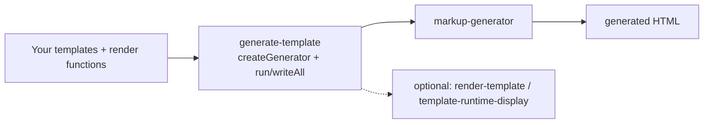

Three newer LLazyEmail packages turn email templates into HTML. Each one has a
single job, and they stack:

| Layer | Package | Job | Repository |
| --- | --- | --- | --- |
| 1. Renderer | `@llazyemail/render-template` | Run a template's named parts, trace each one, compose the HTML | [render-template](https://github.com/LLazyEmail/render-template) |
| 2. Runtime + inspector | `@llazyemail/template-runtime-display` | Email shell (head, main, footer) on top of render-template, plus a live inspector and email checks | [template-runtime-display](https://github.com/LLazyEmail/template-runtime-display) |
| 3. Generation | `@llazyemail/generate-template` | Catalog lookup, payload resolution, `run`/`writeAll`, disk writes through `markup-generator` | [generate-template](https://github.com/LLazyEmail/generate-template) |



This diagram is the one in the generate-template README.

## Installing any of them

All three are published to **GitHub Packages**, not to the public npm
registry. (A package called `render-template` on npmjs.com is unrelated.)
Point the `@llazyemail` scope at GitHub Packages with a token that has
`read:packages`:

```ini
# .npmrc
@llazyemail:registry=https://npm.pkg.github.com
//npm.pkg.github.com/:_authToken=${NODE_AUTH_TOKEN}
```

Each repository has its own `.npmrc` instructions; generate-template and
template-runtime-display ship an `.npmrc.example`. The README names the token
variable each one expects.

## Where the facts live

These pages summarise the packages. The repositories are the source of truth
and win if anything here drifts:

- versions: each repo's `package.json`, GitHub Releases, and the
  [GitHub Packages list](https://github.com/orgs/LLazyEmail/packages);
- API: each repo's `README.md` and `AGENTS.md`;
- history: generate-template's
  [CHANGELOG.md](https://github.com/LLazyEmail/generate-template/blob/main/CHANGELOG.md),
  and the GitHub Releases pages of
  [render-template](https://github.com/LLazyEmail/render-template/releases) and
  [template-runtime-display](https://github.com/LLazyEmail/template-runtime-display/releases),
  which do not keep a CHANGELOG file.

Pages:

- [render-template](./render-template.md)
- [template-runtime-display](./template-runtime-display.md)
- [generate-template](./generate-template.md)
